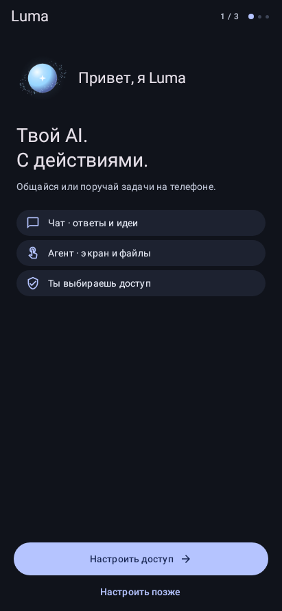
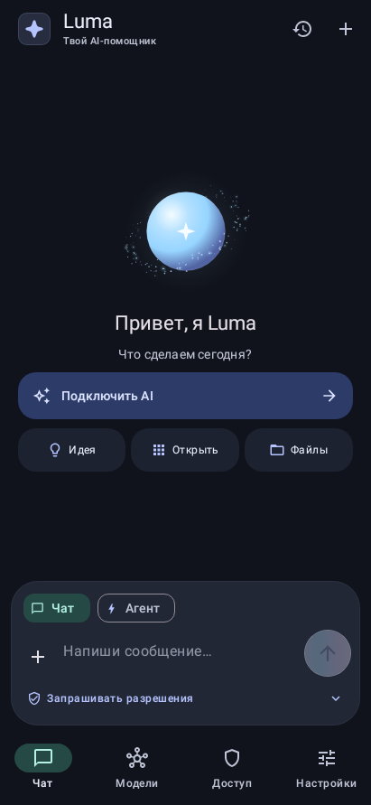
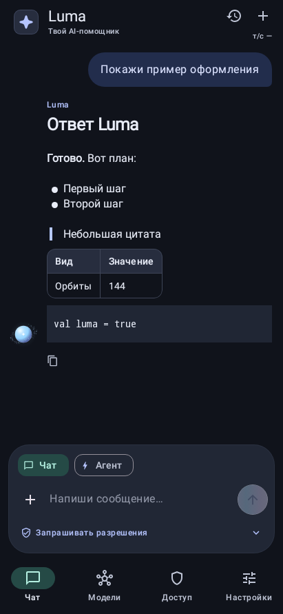
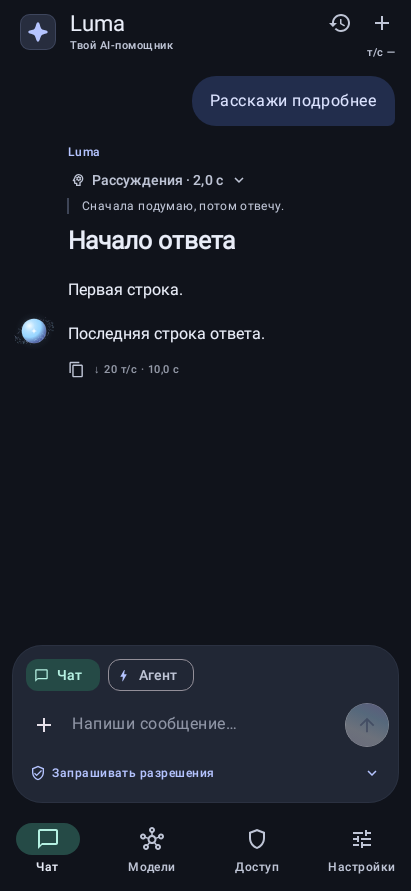
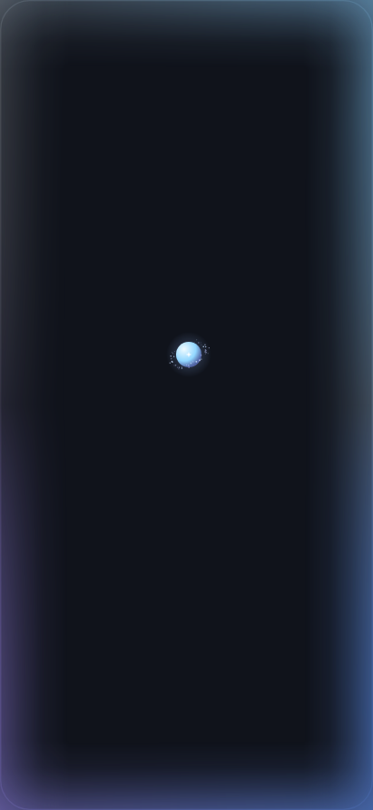

<div align="center">

# ✦ Luma Agent

**AI-чат и агент, который управляет Android-телефоном по вашей команде.**

[](https://github.com/FASTDROPX/Luma-Agent/releases/latest)
[](#установка)
[](https://kotlinlang.org)
[](https://developer.android.com/compose)
[](LICENSE)

    

<sub>Рендер настоящего Android Canvas из тестов Robolectric, не снимки физического телефона.</sub>

</div>

## Возможности

- **Голос**: вызов «Люма» в фоне и на заблокированном экране, диктовка в черновик, непрерывный разговор с любой текстовой моделью и озвучка по кнопке. Локальные и облачные варианты речи выбираются отдельно; [настройка и ограничения](docs/VOICE.md).

- **Чат** с Gemini, OpenRouter, OpenAI, Claude, DeepSeek или своим OpenAI-совместимым сервером (Ollama, LM Studio). Ключ хранится зашифрованным в Android Keystore.
- **Агент**: простые операции — фонарик, громкость, яркость, «Не беспокоить», шторка, будильник, таймер, напоминание, ссылка, файл — выполняет одним прямым вызовом Android API, без поиска переключателей на экране. Для остального читает экран через службу специальных возможностей, нажимает, прокручивает и вводит текст. Работает с файлами только в одной выбранной вами папке. Root, shell, скрытые API и выполнение скриптов отсутствуют.
- **Инструменты под разрешения**: контакты, звонки, SMS, журнал звонков, местоположение, календарь, медиатека, статистика приложений — когда шагу не хватает доступа, агент показывает в чате карточку «Выдать доступ» и продолжает после выдачи. В режиме запросов звонок и SMS подтверждаются отдельно.
- **Необязательные доступы**: раскрывающийся раздел во вкладке «Доступ» — разрешения для отдельных действий, работа в фоне (отключение энергосбережения) и инструменты для данных телефона, каждый доступ со статусом и системным запросом.
- **Глубокие размышления**: включаемый режим, в котором агент после неудачного шага разбирает, почему не получилось, и пробует другой способ (меню по долгому нажатию, ссылка через браузер, другой путь), а не повторяет то же действие.
- **Контроль**: режим «Запрашивать разрешения» или «Полный доступ»; подтверждения действий и «запрещённых слов» действуют в режиме запросов; полный доступ включается отдельным подтверждением и выполняет задачу без дополнительных вопросов Luma. Кнопка «Стоп» доступна всегда.
- **Вложения**: картинки, PDF, текст и код, аудио для Gemini.
- **Markdown, таблицы и формулы LaTeX** без WebView, в цветах приложения; таблицы с колонками по содержимому; блоки кода с подсветкой по языку, кнопками «Копировать» и «Скачать» файлом нужного формата. Картинки по ссылкам не загружаются автоматически.
- **Картинки от модели**: Gemini, OpenRouter и OpenAI рисуют прямо в чат; просмотр на весь экран, сохранение в галерею, «Поделиться».
- **Удобство**: меню сообщения по долгому нажатию, «Переотправить» при сбое, поиск, закрепление, переименование и экспорт чатов в Markdown, смена модели из шапки, «Поделиться → Luma», размер текста, вибрация, тон «ты» или «вы», проверка подключения.
- **Поиск в интернете**: кнопка «Поиск» в обычном и агентском чате. В обычном чате Gemini, Claude, OpenAI и OpenRouter ищут сами; любая другая модель (DeepSeek, локальная) — через Luma: DuckDuckGo без ключа, Tavily, Brave Search или свой SearXNG. Над ответом видно, что модель искала, сколько страниц нашла и прочитала, со списком источников.
- **Черновики**: недописанное сообщение и вложения остаются в каждом чате при переходе в другие меню и после перезапуска.
- **Скорость и рассуждения**: токены в секунду на вход и выход в шапке чата и на кнопке «Стоп», расход токенов за чат и за день, время работы агента и каждого шага, лимит токенов на задачу, сворачиваемые рассуждения модели («Рассуждения ›»).
- **GGUF с Hugging Face**: поиск, загрузка и передача модели в локальное AI-приложение.
- **Оформление**: темы, палитры, цвета обоев Android 12+, Motion blur, анимированная сфера.

## Установка

1. Скачайте `Luma-Agent-<версия>.apk` со страницы [Releases](https://github.com/FASTDROPX/Luma-Agent/releases/latest) и установите.
2. Для агента включите службу «Luma · управление телефоном» в «Специальных возможностях». На Android 13+ для APK не из магазина сначала разрешите «Ограниченные настройки» в информации о приложении.
3. Во вкладке «Модели» подключите провайдера своим API-ключом и выберите модель.

> [!IMPORTANT]
> Luma 0.8.0 подписана новым ключом. Поверх 0.7.0 и более ранних версий она не устанавливается: удалите старую версию, затем установите 0.8.0. API-ключи, история чатов и загрузки при удалении пропадут — подключите провайдера заново. Следующие версии будут ставиться поверх 0.8.0.

> [!NOTE]
> Начиная с 0.5.2 APK подписан новым ключом. Если у вас стоит Luma 0.5.1 или более ранняя версия, подписанная прежним ключом, её нужно удалить перед установкой. Ключи API, история и загрузки при этом удалятся.

Изменения по версиям — в [CHANGELOG.md](CHANGELOG.md).

---

# Подробное описание · 0.9.0

Новые инструменты, разрешения, альтернативные способы и ограничения Android: [матрица возможностей](docs/ACCESS_TOOLS.md).

Отдельный Android-клиент с чатом и агентом. Kotlin, Jetpack Compose, Material 3.
Package `dev.luma.agent`, versionCode 18, minSdk 26, target/compileSdk 35.
Устанавливается отдельно от SimpleCDZ.

## Интерфейс

- Знакомство → разрешения → модель. Компактные экраны без прокрутки на старте;
  подробности разрешений и длинный список моделей открываются отдельно.
- Шар со спутниками на объёмных наклонённых эллиптических орбитах: частицы
  проходят спереди и сзади, скрываясь телом сферы. В приветствии они прилетают
  отдельным узким потоком справа сверху, огибают низ шара и закручиваются
  на орбиты. Позиция и касательная скорость в точке захвата непрерывны;
  дополнительное закручивание постепенно затухает.
- На главном экране и в знакомстве шар вращается свайпом, сохраняя центр.
  Поворот стал туже: чувствительность снижена, палец смещает пружинную цель,
  а тело догоняет её с инерцией. Частицы запаздывают на независимых пружинах;
  орбиты слегка растягиваются при вращении и плавно восстанавливаются.
  После отпускания вращение затухает; через настраиваемые 2–6 секунд бездействия
  ориентация возвращается в исходную. Удержание в главном меню плавно расширяет
  орбиты до 1.32× и разгоняет частицы до 5× выбранной скорости. Примерно за
  7 секунд достигается 99% предела, с мягко затухающим ускорением. Отпускание
  и отмена жеста плавно возвращают исходную скорость и радиус; короткий тап
  не запускает разгон. Маленькая сфера у ответа остаётся без реакции на касания.
- Один шар в чате: из приветствия он плавно уменьшается и перелетает влево,
  затем стоит у последней строки ответа. При чтении старой переписки
  автоматическое следование можно возобновить кнопкой «К последнему».
- Плавающее поле ввода без сплошной нижней подложки. Бело-голубо-фиолетовый
  градиент отправки меняет положение и цвета. При отправке стрелка улетает
  вверх, новый значок приезжает снизу, скорость переливов мягко растёт и затухает.
- Поле ввода показывает набранный текст сразу, без анимации появления букв.
- Ответ появляется сразу целиком и плавно проявляется блоком, без побуквенной анимации.
  Над ответом — сворачиваемые «Рассуждения · N с», если модель их прислала; под ответом —
  «Копировать» и скорость генерации этого ответа.
- В шапке чата — скорость последнего ответа «↑ вход · ↓ выход т/с» (нажатие открывает
  подробности); отключается в «Настройки» → «Оформление» → «Скорость генерации».
- Общий фон чата и нижней навигации, мягкая плавающая карточка ввода.

## Markdown

Markwon / CommonMark + GFM: заголовки, жирный/курсив/зачёркнутый текст, встроенный
код и блоки кода, вложенные нумерованные/маркированные списки, списки задач,
цитаты, разделители, таблицы с выравниванием, ссылки и автоссылки, reference links,
изображения, экранирование и поддерживаемый inline HTML. Текст можно выделять
и копировать. Рендерер не использует WebView и не исполняет HTML/скрипты.

Формулы LaTeX отрисовываются JLaTeXMath; поддерживаются `$$...$$`, `\(...\)`
и `\[...\]` вне блоков кода. Шрифты включены в APK; XML/рефлексивные классы
сохраняются правилами R8. Лицензии и исходники неизменённой библиотеки находятся
в `app/src/main/assets/licenses/` и `third_party/`.

Картинки из ответа не загружаются автоматически: адрес картинки мог бы унести
данные на чужой сервер. Вместо картинки показывается ссылка «🖼 подпись»,
которая открывается в браузере только по нажатию. Для ссылок доступны HTTP(S)/mailto.

Таблицы рисуются отдельно от Markwon: ширина колонки — по содержимому (до 260 dp,
дальше перенос), широкая таблица прокручивается вбок.

Ответы приходят потоком (SSE: chat-completions, streamGenerateContent, messages), но
показываются целиком после окончания. Поток нужен для замера: вход т/с — токены запроса
до первого токена ответа (включая задержку сети), выход т/с — сгенерированные токены
после него. Если сервер не сообщил число токенов, выход оценивается по длине текста и
помечается «≈». Локальный сервер без поддержки потока автоматически получает обычный запрос.

## Вложения

Кнопка «+» открывает системный выбор документов: до четырёх файлов, каждый до
8 МБ, суммарно до 16 МБ. Файлы копируются в закрытую папку приложения; доступ
ко всему хранилищу не запрашивается. Метаданные сохраняются в SQLite v2;
история v1 обновляется без потери сообщений. Удаление последнего чата с файлом
удаляет его локальную копию. Снимки экрана агента в эту историю не записываются.

Картинки уменьшаются до 1600 px, учитывают EXIF и переводятся в JPEG;
прозрачность заполняется белым для читаемости. PDF передаётся штатными частями
Gemini/Claude/OpenAI/OpenRouter. Текст, Markdown, CSV, JSON и исходный код UTF-8
до 256 КБ / 64 000 символов передаются как данные всем провайдерам. Аудио до
8 МБ — Gemini. Поддержка конкретной моделью всё равно требуется: DeepSeek
остаётся текстовым, локальный сервер должен поддерживать vision для картинок.
Неподдерживаемые новые вложения вызывают понятную ошибку. При смене модели
старые несовместимые вложения заменяются явным описанием недоступности.
DOCX, архивы и другие бинарные форматы пока не принимаются.

## Темы и Motion blur

Настройки разделены на оформление, эффекты, параметры модели и управление.
Доступны системная/светлая/тёмная тема, четыре палитры, цвета обоев Android 12+
и чёрный фон. Цветовые роли плавно меняются за 550 мс, включая переключение
обратно во время незавершённого перехода.

«Настройки» → «Эффекты» → Motion blur: размытие при прокрутке списков, инерционном
скролле и переходах вкладок/страниц настроек/онбординга. В покое кадр полностью
резкий. Android 12+ использует направленный RenderEffect, Android 8–11 —
многослойное сглаживание движения. Настраивается сила. Эффект применяется внутри
Luma; обычные поля ввода и неподвижный текст не размываются.

«Меньше анимаций» и системное отключение аниматоров отключают движение,
плавное появление и blur. Изменение системной настройки учитывается при возврате
в приложение. Сфера останавливает кадры в фоне.

## Подключения и модель

Gemini, OpenRouter, OpenAI, Claude, DeepSeek и OpenAI-совместимый локальный сервер.
Ключ сохраняется зашифрованным; вставка из буфера происходит только по нажатию.
Каталог API ограничен 20 с, имеет отмену, ошибки и обновление. Выбор модели
сразу применяется к следующим запросам; ключи/каталоги разных провайдеров раздельны.

Для каждого provider/model ID отдельно сохраняются лимит ответа, температура, Top P, 2–30 сообщений контекста
и системный промпт до 4000 символов. Сэмплирование по умолчанию не отправляется;
известные reasoning-модели сохраняют собственные значения. У Claude при включённой
температуре Top P не отправляется. Агент применяет лимит вывода, сохраняя свой
системный протокол и стандартное сэмплирование. Поле «Системный промпт»
находится в параметрах модели; дублирующий раздел удалён; инструкции передаются в системной роли и чату,
и агенту. Сохранение влияет на следующие сообщения и новые задачи. Активная задача использует
исходные параметры; смена ключа не стирает пользовательские настройки моделей.

**Размер ответа.** По умолчанию — «Авто / максимум модели»: Luma не добавляет своего
ограничения. Gemini, OpenAI, OpenRouter, DeepSeek и локальные серверы получают запрос
без `maxOutputTokens`/`max_completion_tokens`/`max_tokens`. Claude требует это поле, поэтому
получает максимум выбранной модели: из каталога (`max_tokens` в Models API) или по
опубликованной таблице моделей, для неизвестной модели — 64 000. «Без ограничения» не
значит бесконечный ответ: его по-прежнему ограничивают максимальный ответ модели,
контекстное окно и квоты провайдера или сервера. Ручной лимит — отдельная настройка
(256 токенов … максимум модели); она не связана с бюджетом токенов задачи агента и
лимитом шагов. Для Ollama размер контекста задаётся на сервере (`OLLAMA_CONTEXT_LENGTH`
или `num_ctx` в Modelfile); параметры нативного API Ollama в OpenAI-совместимый запрос
не добавляются.

**Ollama на компьютере.** Ollama по умолчанию даёт модели контекст 4096 токенов,
а инструкции агента вместе с деревом экрана в него не помещаются, и Ollama молча
обрезает запрос. Создайте вариант с большим контекстом:

```
FROM <ваша модель>
PARAMETER num_ctx 12288
```

`ollama create luma-model -f Modelfile`, затем в Luma: «Модели» → «Локальный сервер» →
`http://<IP компьютера>:11434/v1/` (телефон в той же сети; VPN на телефоне может
блокировать локальную сеть). Для эмулятора Android удобнее `adb reverse tcp:11434 tcp:11434`
и адрес `http://127.0.0.1:11434/v1/`. Модели с рассуждениями (Qwen3) думают над шагом
до минуты и дольше; для агента нужна модель уровня 8B и выше, и даже она ошибается чаще
облачных.

**Сервер дома, телефон в другом городе.** Проще всего через [Tailscale](https://tailscale.com):
частная зашифрованная сеть между вашими устройствами, без проброса портов и без открытого
в интернет сервера.

1. Установите Tailscale на ПК и на телефон и войдите в один аккаунт.
2. На ПК откройте сервер для сети, а не только для localhost. У Ollama: переменная окружения
   `OLLAMA_HOST=0.0.0.0` (в Windows — «Переменные среды», затем перезапуск Ollama);
   у LM Studio — «Serve on Local Network». Разрешите порт в брандмауэре.
3. В Luma: «Модели» → «Локальный сервер» → `http://100.x.y.z:11434/v1/` (адрес ПК в приложении
   Tailscale) или `http://имя-пк.имя-сети.ts.net:11434/v1/`.

ПК должен быть включён, а на телефоне — запущен Tailscale; на Android одновременно работает
только один VPN. Не открывайте Ollama напрямую в интернет: у неё нет своей защиты. Если сервер
доступен из интернета (Cloudflare Tunnel, обратный прокси), Luma требует HTTPS, а ключ сервера
передаётся заголовком `Authorization`.

Обычный HTTP разрешён для localhost, локальной сети (10/8, 172.16/12, 192.168/16,
169.254/16, *.local, IPv6 ::1, fc00::/7, fe80::/10) и сети Tailscale (100.64/10, *.ts.net);
трафик Tailscale шифруется самим Tailscale. Любому другому серверу нужен HTTPS. Это проверяется и при сохранении адреса, и в самом HTTP-клиенте.
В URL не принимаются ключи/учётные данные и query/fragment.

## Агент

В чате и настройках управления доступны «Запрашивать разрешения» и
«Полный доступ». Выбор сохраняется, при активной задаче селектор отключён.
Первый режим подтверждает шаги с действиями и совпадения с «Запрещёнными словами».
При включении полного доступа Luma отдельно спрашивает, действительно ли вы этого хотите.
После согласия все действия порученной задачи, включая удаление и перезапись файлов,
выполняются без дополнительных подтверждений Luma. Режим не выдаёт разрешения Android,
не расширяет выбранную папку и не отменяет системные диалоги камеры, установки APK и других операций.
В «Доступе» и при первом знакомстве есть «Запросить все разом»: обычные диалоги,
затем специальные настройки и папка, а управление экраном — последним. Любой пункт можно пропустить.

В панели сообщения остаются «Чат» и «Агент». Поиск и глубокие размышления находятся
в шторке параметров. Щит управления экраном скрывается, когда служба подключена.
Историю можно очистить целиком после подтверждения; выполняющаяся задача сначала останавливается.
В выбранной рабочей папке файлы при очистке истории не удаляются.

Созданные прямыми файловыми инструментами файлы появляются карточками под итогом:
имя с расширением, время сохранения, размер, повторное сохранение копии и открытие расположения.
Если файловый менеджер не поддерживает переход к расположению, Android открывает системный
проводник или просмотрщик файла. Файлы, созданные через интерфейс стороннего приложения,
не добавляются автоматически: Android не возвращает Luma их URI.
Палитры дополнены фиолетовой, кобальтовой, розовой, бирюзовой, лимонной, оранжевой и графитовой.
Проверки соединения используют Material 3 Expressive LoadingIndicator, загрузки — волнистый прогресс;
при уменьшении движения анимации отключаются.

Служба специальных возможностей получает дерево текущего окна. На Android 11+
может передавать снимок, если пользователь включил его и модель поддерживает vision.
Парольные поля и внутренний интерфейс Luma скрыты. Служба без активной задачи
не читает экран и не запускает автоматизацию.

### Прямые действия

Для простой операции модель сразу вызывает прямой инструмент; управление экраном —
запасной путь, когда подходящего инструмента нет. «Одно действие» — один вызов инструмента
моделью: проверки и системные вызовы внутри Luma выполняются без дополнительных обращений
к модели. Каждый результат возвращает статус: `done` (с `verified`, если Android позволяет
проверить), `needs_confirmation`, `needs_user_action` (с подсказкой `userAction`),
`unsupported`, `denied`, `error` или `unknown`.

| Напрямую, с проверкой состояния | Через системную панель или подтверждение | Только открыть настройки (переключает пользователь) |
|---|---|---|
| Фонарик; громкость каналов и отключение звука; режим звонка; медиа; буфер обмена (запись); состояние батареи, сети, времени, звука, экрана, памяти; шторка, быстрые настройки, недавние, домой, назад, блокировка (Android 9+), меню питания, снимок экрана; стандартные свайпы; приложения, ссылки, deep links, страницы настроек; будильник, таймер (без проверки — Android не показывает таймеры); напоминания Luma; файлы в workspace:/ | Wi‑Fi (Android 10+), мобильный интернет, NFC; включение Bluetooth (Android 13+, нужно «Устройства поблизости»); событие календаря (форма); `tel:`, `mailto:`, `sms:` открывают только набор номера или черновик | Геолокация, авиарежим, точка доступа (её состояние тоже недоступно), выключение Bluetooth на Android 13+ |

Требуют разрешения, которое выдаёт сам пользователь («Доступ» → «Системные действия»):
яркость и автоповорот — «Изменение системных настроек»; «Не беспокоить» и звонок в этом
режиме — доступ к «Не беспокоить»; точное время напоминаний — «Будильники и напоминания».
Без разрешения инструмент ничего не меняет и сообщает, что нужно сделать. Wi‑Fi и
Bluetooth переключаются напрямую только на старых версиях Android (до 10 и до 13), где
это ещё разрешено обычным приложениям. Чтение буфера обмена на Android 10+ недоступно
приложению не на экране; в режиме запросов чтение ждёт подтверждения, потому что текст уходит модели.
Отключить подтверждение системных разрешений Android агент не может.

Модель получает компактный каталог (одна строка на группу инструментов), сводку
возможностей этого устройства и текущее время с часовым поясом; подробности по
конкретному инструменту — через `describe_tool`. Для серверов с вызовом функций
(OpenAI-совместимые, Claude, Gemini) вместо текстового каталога отправляются JSON-схемы.
Локальная модель без поддержки инструментов автоматически переходит на JSON-команды
(«Агент» → «Вызов инструментов»: Авто, Функции, JSON).

Для будильников, таймеров, событий и напоминаний сохраняются время, длительность,
название, часовой пояс и повторение; если пользователь их не назвал, модель спрашивает.
Будильник в другом часовом поясе пересчитывается в местное время «Часов» вместе с днями
недели. Напоминания Luma переживают перезагрузку и сохраняют время по часам при переходе
на летнее время.

Свайпы `swipe_screen` считаются от размеров экрана и не требуют снимка или vision
(например, шторка жестом: `direction=down, edge=top`). Нажатие по координатам без снимка
разрешено только внутри элемента из последнего дерева экрана; для произвольных координат
проверяются границы, актуальность экрана и аргументы. На экранах системных разрешений
жесты и нажатия агента запрещены.

Действие с побочным эффектом, результат которого неизвестен (например, Android не
подтвердил жест), не повторяется автоматически: повтор ждёт подтверждения пользователя.

### Рабочая папка

Файлы ограничены одной папкой Storage Access Framework, выбранной пользователем. Модель
видит её как `workspace:/` с названием, расположением («Внутренняя память › Documents»),
правами чтения и записи и состоянием доступа; настоящий content:// URI хранится только
внутри Luma, физический путь не выдумывается. Относительные пути и `workspace:/…`
разрешаются внутри папки, выход за неё отклоняется. «Создай test.txt» — сразу `write_text`:
существование и права проверяются внутри, недостающие папки создаются, существующий файл
без явной замены не меняется (замена — с подтверждением и резервной копией). Есть также
`append_text`, `create_folder`, `file_info`, `search_files`, переименование, копирование,
перемещение и удаление файлов и пустых папок. Если папка не выбрана или доступ потерян,
задача сразу заканчивается сообщением, как открыть системный выбор папки.

При запуске шар из чата передаёт свою экранную позицию, размер и положения
спутников слою управления. Он плавно перелетает в центр и превращается в курсор;
частицы догоняют его на независимых пружинах и продолжают вращаться вокруг.
Перелёты курсора используют quintic easing с нулевой скоростью и ускорением
на концах. Свечение появляется за 700 мс, покрывает четыре стороны экрана,
плавно меняет цвет и прозрачность. Мягкие поля затухают на 76 dp; тонкое ядро
1.33 dp. Итоговая непрозрачность обводки ограничена 90% даже в углах.
Центр экрана прозрачен. При отключении анимаций эффекты статичны.
Рисующий слой пропускает касания. Отдельная кнопка «Стоп» остаётся доступной
при отключении панели и эффектов; перед координатным жестом она избегает траектории.
Все слои временно скрываются для снимка через try/finally. После перелёта курсора
повторно проверяются окно, узел, размеры экрана, блокировка, пауза и отмена.

Пока курсор летит, его частицы вытягиваются в узкий изогнутый поток вдоль пути, как в
приветствии, а на месте закручиваются обратно на орбиты с затухающим вращением.
Кнопка «Стоп» второй строкой показывает время работы задачи и скорость «↑ ↓ т/с»;
кнопка-панель «✦» стоит в одном ряду с ней и той же высоты. Время работы есть и в
карточке агента в чате.

Дополнительная панель позволяет подтвердить шаг, поставить паузу и открыть чат.
Плитка «Панель Luma» меняет видимость этой панели только во время задачи.

В режиме запросов изменяющие действия требуют подтверждения. В полном доступе
подтверждения Luma, включая удаление, перезапись и запрещённые слова, отключены.
Разрешения Android выдаются вручную. Отказ завершает
задачу. По умолчанию включён режим «Без лимита шагов»: нет общего предела времени
и количества решений модели. В настройках агента можно вернуть ограничения
5–30 шагов и 2–15 минут. Повторяющиеся без изменений действия ставят задачу на
паузу; пользователь может продолжить или остановить её. Ограничения Android,
контекстного окна, квот и оплаты выбранного провайдера сохраняются.
Остановка отменяет запрос/ожидание и дальнейшие шаги. Уже переданный
Android жест или начатая операция файлового провайдера могут завершиться;
выполненные действия не откатываются.

## Экономия запросов агента

Каждый запрос содержит исходную задачу, до 4000 символов предыдущей переписки,
рабочие заметки до 4000 символов, краткий журнал последних десяти команд и только
последний полный результат инструмента (до 24000 символов, при сокращении есть
явная отметка). Старые деревья экранов, снимки и прочитанные файлы не накапливаются
в запросах. Вложения текущей пользовательской задачи сохраняются в контексте,
так как могут быть нужны для её выполнения. Важные факты модель сохраняет
инструментом remember; заметки заменяются, а не добавляются бесконечно.

После изменения интерфейса приложение само возвращает компактное дерево нового
экрана вместе с результатом действия, без отдельного решения модели для screen.
В обычном дереве до 60 элементов; query позволяет найти конкретный текст,
detailed:true возвращает до 120 элементов. ID и координаты элементов сохраняются.
Пустые и повторяющиеся поля не отправляются. Скриншот делается только по явному
screen image:true, при разрешении пользователя и поддержке vision. Открытие
приложения рекомендуется через list_apps/open_app, без поиска по рабочему столу.
Четыре одинаковых сочетания команды и результата в последних двенадцати шагах
вызывают паузу. Смена snapshot сама по себе не считается прогрессом. В приложениях без
дерева элементов (игры) шаги ещё сравниваются по отпечатку последнего снимка экрана:
если картинка меняется, это не повтор. Gemini получает координаты в шкале 0–1000.

Сводка возможностей устройства и описание папки собираются один раз при запуске задачи,
поэтому системный промпт не меняется между шагами. Прямые действия не прикладывают дерево
экрана к результату; его получают только действия, меняющие экран.

Это ограничивает рост контекста, но не делает запросы бесплатными: системный
промпт и рабочие данные снова передаются провайдеру. Реальная стоимость зависит
от модели, её рассуждений, изображений, кэширования и тарифов API. Заявленный
процент экономии на реальном API не измерялся.

## Временные ошибки API

Для генерации есть до трёх попыток при 408/429/5xx и сетевом сбое до ответа:
задержки 1 и 2 с, Retry-After учитывается до 8 с. Ошибки ключа/доступа/модели
401/403/404 не повторяются. Каталог сохраняет собственный предел 20 с.

После исчерпания временных повторов агент остаётся активным с текущим
контекстом. Кнопка «Повторить запрос» в чате/панели продолжает именно запрос
модели, сохраняя уже выполненные инструменты. «Стоп» отменяет ожидание и backoff.
Обычный чат после исчерпания попыток показывает ошибку. Доступность внешнего
провайдера и восстановление после завершения процесса не гарантируются;
общий лимит времени задачи продолжает действовать.

## GGUF с Hugging Face

«Модели» → Hugging Face: публичные GGUF, список файлов/размеров, подтверждение
загрузки и Wi-Fi. DownloadManager продолжает работу в фоне. Доступны прогресс,
отмена, повтор, удаление и передача готового файла локальному AI-приложению.
Файлы закреплены за commit SHA; проверяются точный размер и заголовок GGUF,
лимит 32 ГБ, резерв свободного места и до двух одновременных загрузок.
Полная криптографическая проверка многогигабайтных весов не выполняется.

Приватные/gated-модели не загружаются без отдельного входа; ключи AI сюда не
передаются. Файлы в `externalFilesDir/Download/huggingface` удаляются вместе
с приложением. FileProvider выдаёт временный доступ только к выбранному файлу.
Встроенного inference-движка нет: запусти GGUF в совместимом приложении и подключи
его OpenAI API как локальный сервер.

## Хранение и установка

Весь конфиг: AES-GCM / Android Keystore, AtomicFile в noBackupFilesDir. История:
SQLite в той же папке. Резервное копирование выключено; ключи не попадают в
промпты/URL/логи, экран ключа защищён FLAG_SECURE. Снимки живут в памяти и не
записываются в историю. Выбранный провайдер получает содержимое запроса и
разрешённые пользователем материалы задачи.

Устанавливай APK поверх предыдущей версии. Для агента включи службу Luma
в специальных возможностях Android; на некоторых Android 13+ сначала разреши
«Ограниченные настройки» в информации о приложении. Подробная инструкция
находится во вкладке «Доступ». Разрешения необязательны для обычного чата.

## Сборка и проверки

Полный OpenJDK 17/21 (например, Temurin), SDK 35 / build-tools 35.0.0. Gradle wrapper
8.11.1 с SHA-256, AGP 8.9.2, Kotlin/Compose compiler 2.1.20, Compose BOM 2025.04.01.
Oracle JDK не подходит для тестов: он не принимает тестовый провайдер Keystore.

```bash
python3 tools/bootstrap.py   # только Linux; на Windows/macOS SDK ставится через Android Studio
./gradlew --no-daemon :app:testDebugUnitTest :app:lintDebug :app:assembleRelease
LUMA_SIGN_PASS=... python3 tools/package.py --sdk /path/to/sdk --keystore /outside/project/luma.p12
```

Упаковка проверяет актуальность release, R8, ZIP, выравнивание 16 КБ и подпись
v2/v3; создаёт APK, SHA-256 и архив исходников без локальных данных/секретов.
Пароль обязательно передаётся через LUMA_SIGN_PASS. Ключ подписи хранится вне проекта.

Релиз можно собрать в GitHub Actions: workflow `Release` запускается тегом `v<версия>`,
прогоняет тесты и Lint, подписывает APK ключом из секретов репозитория
(`LUMA_KEYSTORE_BASE64`, `LUMA_SIGN_PASS`, необязательно `LUMA_KEY_ALIAS`), проверяет, что
это тот же ключ, что у прошлых версий, и публикует APK, `.sha256` и архив исходников.

Результаты и границы проверки — [BUILD_REPORT.md](BUILD_REPORT.md).
Рендер Robolectric Native Graphics — `app/build/previews`. Реальное устройство,
частота кадров, инъекция Accessibility-жестов и запросы с пользовательским ключом
в этом окружении не проверялись.
